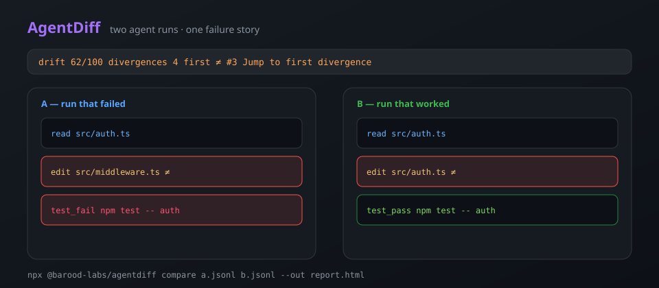

# AgentDiff

<p align="center">
  <a href="https://www.npmjs.com/package/@barood-labs/agentdiff"></a>
  <a href="https://github.com/barood-labs/agentdiff/actions/workflows/ci.yml"></a>
  <a href="https://barood-labs.github.io/agentdiff/"></a>
  
</p>

**Two AI coding-agent sessions. One side-by-side failure diff — plus a plain-English “why they forked.”**

Point it at two Claude Code or Codex runs of the same task. AgentDiff aligns their tool-call timelines, jumps to the first divergence, writes a narrative summary you can paste into Discord/PRs/X, and ships a single offline HTML report.



## Install

```bash
npx @barood-labs/agentdiff compare run-a.jsonl run-b.jsonl --out report.html
# or two session folders:
npx @barood-labs/agentdiff compare ~/.claude/projects/.../a ~/.claude/projects/.../b
npx @barood-labs/agentdiff demo --open

# Markdown summary (Discord / PR / X-ready):
npx @barood-labs/agentdiff compare a.jsonl b.jsonl --md
```

Open `report.html`. No account. No upload. No cloud deps in the viewer. Hit **Copy summary** in the report banner to grab a shareable one-liner + bullets.

**Live gallery:** [barood-labs.github.io/agentdiff](https://barood-labs.github.io/agentdiff/)

## Why

AgentTown replays **one** session as a city. WhyDiff scores **one** diff. AgentDiff answers the question you actually ask in Discord:

> “These two agents got the same prompt — where did the bad one go off the rails?”

Typical divergences it highlights:

- different files edited
- different shell commands
- one side errored / failed tests
- steps only present on A or B

## What you get

| Piece | Detail |
|-------|--------|
| CLI | `compare`, `demo`, `--json`, `--md`, `--out`, `--open`, folder or `.jsonl` |
| Parsers | Claude Code + Codex JSONL (adapted from [AgentTown](https://github.com/barood-labs/agenttown), MIT); home paths redacted to `~` |
| Align | LCS on actionable steps (read/edit/write/bash/test/…) |
| Explain | Plain-English headline + bullets (`explainDiff` / `renderMarkdown`) |
| Report | Dark single-file HTML: story banner, dual timeline, scrubber, “first divergence” jump, Copy summary, tool histograms, drift score |
| Keys | `j`/`k` next/prev ≠ · `←`/`→` step · `f` jump to first |
| Fixtures | `examples/login-bug`, `flaky-test`, `wrong-file` |

## Drift score

Rough 0–100 “how far apart”: share of diverging aligned rows, plus file asymmetry and error asymmetry. Not a model quality ranking — a debug compass.

## Library

```js
import {
  loadSession,
  compareSessions,
  renderReport,
  explainDiff,
  renderMarkdown,
} from "@barood-labs/agentdiff";

const a = loadSession("a.jsonl");
const b = loadSession("b.jsonl");
const diff = compareSessions(a.session, b.session);
console.log(explainDiff(diff).headline);
console.log(diff.firstDivergence, diff.drift, diff.stats);
```

## Gallery

After `npm run build`, open `docs/index.html` for the three fixture reports — or use the [live gallery](https://barood-labs.github.io/agentdiff/). Push to `main` also deploys Pages via `.github/workflows/pages.yml`.

## Develop

```bash
npm test          # node:test
npm run build     # write docs/*.html gallery
npm run demo      # compare login-bug → /tmp/agentdiff-demo.html
```

## Not in v0.2

Live webhooks, cloud agent APIs, Cursor log format, GIF export, SaaS.

## License

MIT © barood-labs

Session parsers adapted from `@barood-labs/agenttown` (MIT). Divergence framing inspired by `@barood-labs/whydiff` (MIT).
